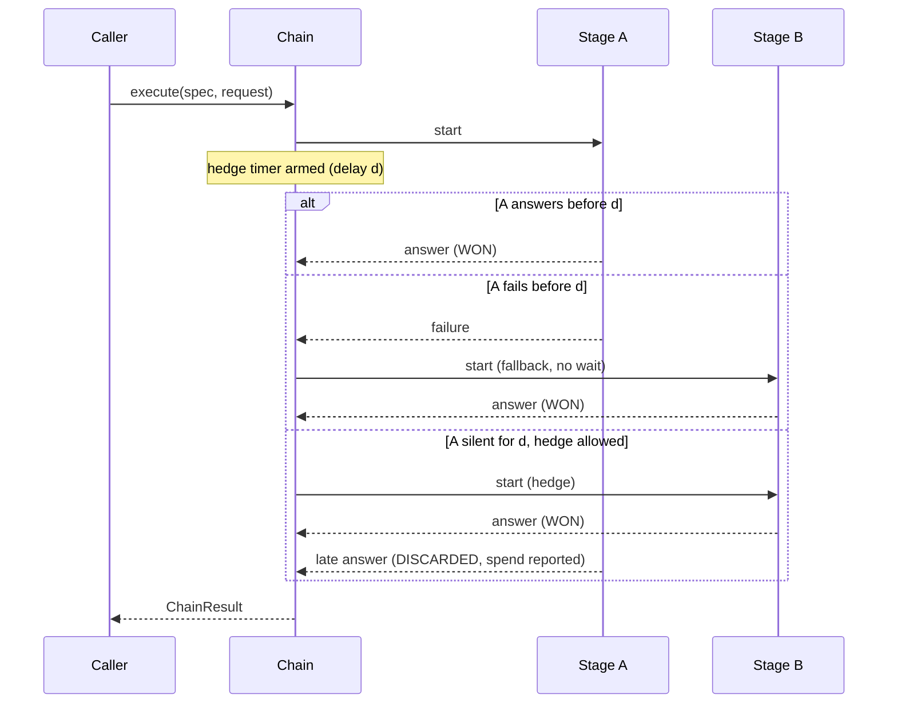

# Concepts

## Stage

A **stage** is one provider called with one model: `StageRef(provider, model)`, written
`provider:model`. Stages are the unit of everything else:
- the breaker keeps state per stage;
- prices are looked up per stage;
- usage is reported per stage attempt.

An **attempt** is one stage execution. Retries of transient errors on that stage happen inside it.
`StageContext.attempt()` counts those calls.

## Chain

A **chain spec** is the ordered list of stages a call should try:

```
primary:model-a, backup, third:model-c
```

- **Pinned entries** (`provider:model`) run exactly that model.
- **Unpinned entries** (`provider`) expand into the provider's `defaultModel()` followed by its other
  `models()`. That gives an intra-provider fallback before moving to the next provider.
- **Unknown providers** in the spec are skipped and reported (`SkipReason.UNKNOWN_PROVIDER`).
- **Unavailable providers** (`available() == false`, for example no API key) are skipped without
  counting as failures (`SkipReason.UNAVAILABLE`).

A call runs the chain in a **pass**: stages are started in order, and the first valid answer wins.

- **Failure.** A stage that fails starts the next one at once. Nothing waits for a timer.
- **Open breaker.** A stage whose breaker is open is skipped.
- **Fail-open.** If the pass skipped every stage because of the breaker and attempted none, a second
  pass runs ignoring the breaker. The breaker exists to save time on known failures; it must never
  turn "everything was failing a minute ago" into a fake outage.
- **Exhaustion.** If every attempted stage failed, the call throws `ChainExhaustedException`. Its cause
  is the last real failure.



## Hedging

When the running stage has been silent for the **hedge delay**, the next stage starts next to it. The
first valid answer wins; the other stage is not interrupted. Its answer is reported as `DISCARDED`
with its usage, because the tokens were paid for.

The delay depends on the kind of call:
- **interactive** (`CallOptions.interactive()`): someone is waiting, so the delay is shorter;
- **background**: nobody is watching, so the delay is longer.

When the timer fires, the hedge is **suppressed** in three cases. Each suppression is reported to
`ChainEventListener.onHedgeSuppressed`.

| Reason | Why it is right to wait in line |
|---|---|
| `STREAM_STARTED` | The running stage already streamed text. It is not silent; it is writing a long answer. |
| `LIMITER_SATURATED` | No free permit. A hedge would add load exactly when there is the least headroom. |
| `COST_CAP` | The candidate costs more than `maxCostRatio` × a stage in flight. A quality-ordered chain puts the expensive model next; hedging it against a cheap stage that would have answered pays twice for nothing. |

**The cost rule.**
- It compares the price of the same **basket** of tokens on both models. The default basket is one
  million input and one million output tokens. The ratio therefore depends on prices only, not on how
  long this answer will be.
- An unknown or free price never blocks a hedge. The rule protects against paying much more to lose a
  race, not against paying.
- It also applies to any stage that would start while another is in flight, for example when a hedged
  stage fails while the first one still runs.

**Re-arming.** After a hedge starts, the timer re-arms for the following stage. With three stages and
delay `d`, the second starts at `d` and the third at `2d`, as long as nobody has answered and the rules
allow it.

Hedging is **off** until you configure a delay. See the [tuning guide](guides/hedge-tuning.md).

## Stall

A **stall** is the signature of a provider that accepts connections and does not answer. The breaker
counts it on calls **still in flight**.

- **The condition.** A stage is treated as open while at least `stallThreshold` of its calls have been
  in flight for at least `stallAfter`.
- **One slow call is not a stall.** It is slowness. Several calls stuck together are a symptom.
- **It is computed, not stored.** It disappears as soon as those calls end, with no cooldown. A false
  positive therefore costs little: new calls use the next stage for a while.
- **What it adds.** A breaker that counts completed failures cannot see this until the timeouts expire,
  and cannot save the first burst of calls hit by the outage.

Each call registers itself with `StageBreaker.begin(stage)` and closes the returned handle when it
ends. The chain does this for you.

## Breaker states

| Status | Meaning |
|---|---|
| `CLOSED` | Calls go through. |
| `OPEN` | Cooldown after `failureThreshold` consecutive failures (short), or after a permanent error such as 404/410 (long, opened at once). |
| `HALF_OPEN` | The cooldown expired. The next call tries the stage; a failure reopens the cooldown at once. |
| `STALLED` | No cooldown, but enough calls stuck in flight. |

What moves the counters:

| Event | Effect |
|---|---|
| A valid answer, even one that lost the race | Closes the breaker. It measures availability, not who won. |
| An output rejection | Nothing: the provider is up and the content is wrong. |
| A content refusal (`ErrorKind.CONTENT`) | Nothing. |

## Shared verdict

With several processes, each in-memory breaker would learn about an outage on its own. A
`SharedVerdictStore` shares the **verdict**: "stage X is cooling down for N more ms".

- **The verdict is a key's TTL.** Expiry is the mechanism, and it is measured by the store, not by
  the processes' clocks.
- **Adoption.** Each process reads a stage's verdict at most once per `sharedRefresh`. It adopts a
  longer cooldown and never shortens its own.
- **Success.** A success clears the shared key, so a recovered provider rejoins the processes that have
  not adopted the cooldown yet.
- **Manual reset.** A reset publishes a **marker** with its time, and every process closes the
  cooldowns it opened or adopted before it. A missing key alone cannot tell "expired" from "reset".
- **Best effort.** Store failures degrade to the local breaker. The Redis implementation bounds every
  command with its own timeout.

Counters and stalls stay local.

## Output rejection

An `OutputValidator` can reject an answer, for example when JSON fails to parse. For the chain, a
rejection is a failed stage: the next one is tried, and the spend is reported as `REJECTED`.

After `maxConsecutiveRejections` rejections in a row (default 2), the chain stops. Two different models
failing the same check means the defect is probably in the prompt or the validator, and continuing
would only pay for it again. The exception is then an `OutputRejectedException`: the right diagnosis,
rather than the last network error met along the way.

A failure of another kind in between resets the count.

## Abandoned spend

A call abandoned by `callTimeout`, or cut off mid-body, has usually been generated and billed: the
caller just stopped listening before the usage arrived.

- **When the chain estimates.** The `ErrorClassifier` says whether the generation had started. If it
  had, the `AbandonedSpendEstimator` estimates the tokens, and the usage event carries
  `estimated = true`.
- **When it does not.** Explicit rejections (rate limits, authentication, bad requests) and failures
  before the request was sent are never estimated.

## Cancellation

A `CancellationToken` stops the chain cooperatively:
- no new stage starts and no retry is attempted;
- the call returns `ChainCancelledException` at once.

Calls already in flight finish on their own, and their spend is still reported.

## Streaming

Pass a `StreamListener` in `CallOptions`; providers call `StageContext.emit(text)`. The rules:

- **One owner.** The first stage that emits owns the preview, and pieces from other stages are
  dropped.
- **Reset.** If the owner fails or restarts (a retry), the listener receives `reset()` and the seat is
  free again.
- **Close.** After the call returns, nothing reaches the listener.
- **Preview only.** The final text is the one in `ChainResult`.

## Time

Every notion of time goes through `ChainClock`:
- reading the time;
- one-shot timers;
- sleeping.

`ChainClock.system()` is the real one. `ManualChainClock` moves only when a test calls `advance(...)`,
runs due timers in order, and turns `sleep` into an instant advance. The chain's coordinator never
waits on wall-clock time, so tests of hedging, cooldowns, stalls and timeouts need no sleeps.
